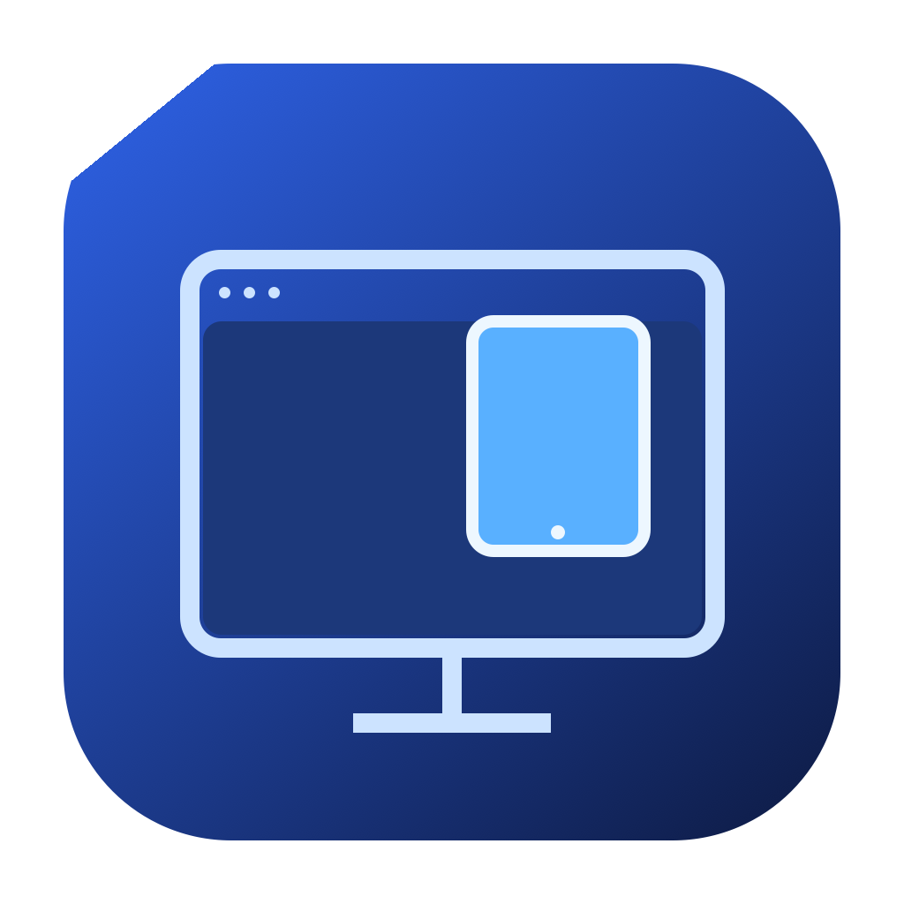

# Device Mirror

**Mirror your iPad in a Mac window.**

Device Mirror receives an iPad screen over AirPlay or USB and displays it in a window you can resize, move, minimize, or keep on top. It is designed for showing notes, presenting documents, and sharing an iPad view during calls.

[简体中文](README.zh-CN.md) · [Release notes](release/NOTES.md) · [Build guide](docs/BUILDING.md)

## Features

- Wireless mirroring through the iPad's built-in **Screen Mirroring** menu.
- USB screen capture, with a device selector.
- Resize while preserving the picture's proportions; pin the window with **⌘T**.
- Ordinary AppKit drawing for compatibility with window sharing, including a fix developed for a Zoom web sharing black screen.
- Pairing progress and a **Copy connection diagnostics** button.
- Local operation without an account, subscription, or cloud relay.

The current interface is in Simplified Chinese.

## Install

Download `DeviceMirror-0.1.4-macOS-arm64.zip` from **[Releases](https://github.com/huangshuai0809-collab/device-mirror/releases)**, unzip it, and open **Device Mirror.app**. You can move it to Applications.

- **macOS 14 or later.** The downloadable build is for **Apple Silicon**.
- This is a preview with an ad hoc signature; it is **not notarized by Apple**. If macOS blocks it, review its entry in **System Settings → Privacy & Security**.
- Quit an older copy with **⌘Q** before opening the new version.

### AirPlay

1. Connect your iPad and Mac to the same Wi-Fi network.
2. Select **无线 AirPlay** in the app and allow local network access when prompted.
3. On iPad, open **Control Center → Screen Mirroring → Device Mirror**.
4. If asked, enter the four-digit code displayed in the Mac window.

### USB

1. Connect an unlocked iPad with a cable that supports data transfer.
2. Tap **Trust This Computer** on iPad if prompted.
3. Select **USB 数据线**, allow video-device access, and choose the iPad.

USB currently displays video only; sound stays on iPad. macOS lists the required video-device permission under **Privacy & Security → Camera**.

### Share in Zoom

First connect the iPad, then choose the **Device Mirror window** in Zoom's sharing picker. After restarting Device Mirror, stop the old share and select the new window again.

## Build and check

Install Apple's Command Line Tools, then run:

```sh
python3 prepare_vendor.py --download
python3 build.py ./dist
"./dist/Device Mirror.app/Contents/MacOS/DeviceMirror" --render-test
"./dist/Device Mirror.app/Contents/MacOS/DeviceMirror" --protocol-test
```

The downloader verifies pinned SHA-256 hashes. No Homebrew packages are needed. Complete source release archives include the upstream archives, so `prepare_vendor.py` also works offline without `--download`.

See [BUILDING.md](docs/BUILDING.md) for packaging and media checks.

## Preview status

The project was manually used with **iPadOS 26.3** and an **Apple Silicon Mac running macOS 26.5.1**. It also has automated checks for first-time PIN pairing, reconnection, rejecting incorrect PINs, and converting and drawing moving video frames.

AirPlay audio is experimental. USB audio and remote control of iPad are not implemented. Other hardware, Intel builds, and conferencing-app combinations have not been comprehensively tested.

If a connection stalls, click **复制连接诊断** and include the resulting text in a bug report.

## Credits and license

Device Mirror uses [UxPlay](https://github.com/FDH2/UxPlay) for its AirPlay protocol implementation, plus libplist and OpenSSL. Its window, USB capture, bitmap renderer, and diagnostics use Apple's native frameworks.

The project is **GPL-3.0-or-later**. See [LICENSE](LICENSE), [THIRD-PARTY.md](THIRD-PARTY.md), and [LICENSES](LICENSES) for component notices. Original upstream sources and the local UxPlay patch are available with the source distribution.
