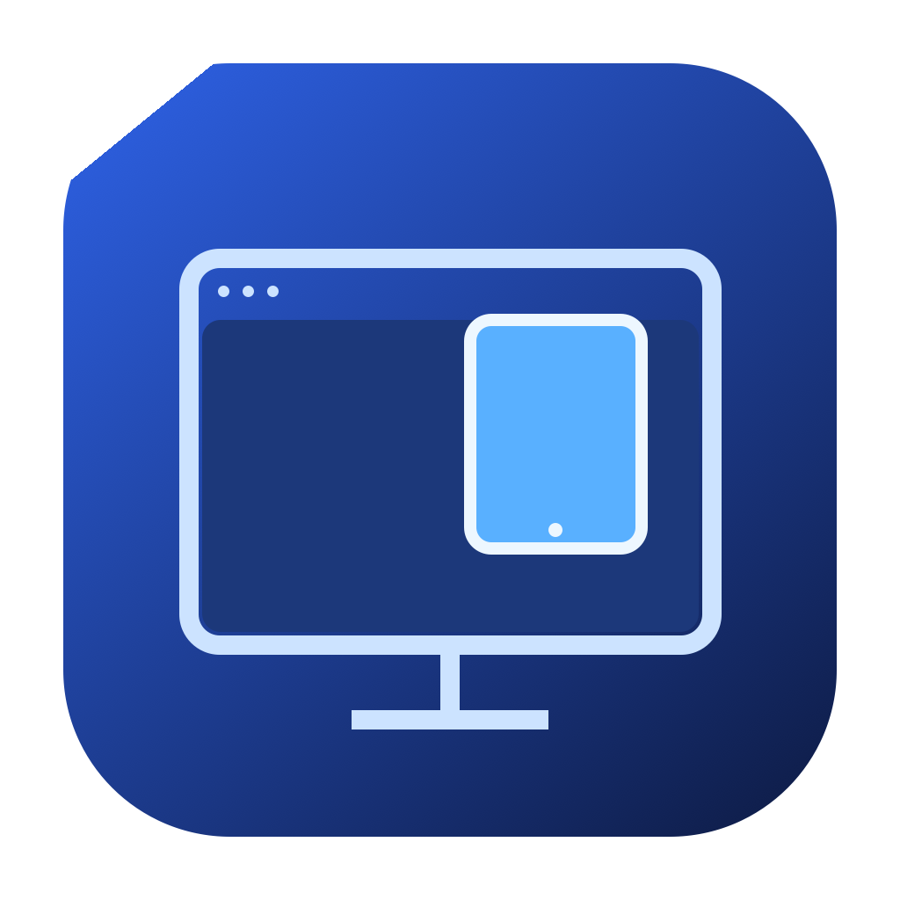

# Device Mirror

**把 iPad 投屏到 Mac 的一个窗口里。**

支持无线 AirPlay 和 USB 数据线。窗口可以移动、缩放、最小化和置顶，适合讲解笔记、展示文档和会议共享。

[English](README.md) · [发布说明](release/NOTES.md) · [构建说明](docs/BUILDING.md)

## 功能

- 在 iPad 自带的「屏幕镜像」中连接，无线投屏无需安装 iPad App。
- 支持 USB 屏幕捕获和设备选择。
- 保持画面比例，支持置顶（⌘T）和重新连接（⌘R）。
- 采用普通窗口绘图，改善会议软件共享窗口时的兼容性；包含针对 Zoom 网页版黑屏问题的显示方式调整。
- 显示配对进度，可复制连接诊断。
- 本地运行，不需要账号、订阅或云端中转。

## 安装和使用

从仓库的 **[Releases](https://github.com/huangshuai0809-collab/device-mirror/releases)** 下载 `DeviceMirror-0.1.4-macOS-arm64.zip`，解压并打开 `Device Mirror.app`，也可以把它移到「应用程序」。

需要 **macOS 14 或更新版本**，现成安装包适用于 **Apple Silicon Mac**。目前是采用临时签名的预览版，未做 Apple 公证；如系统阻止打开，请在「系统设置 → 隐私与安全性」中查看该 App 的打开选项。

更新前先用 **⌘Q** 退出旧版。

### 无线 AirPlay

1. iPad 和 Mac 连接同一 Wi-Fi。
2. App 中选择「无线 AirPlay」，按提示允许本地网络访问。
3. iPad 打开「控制中心 → 屏幕镜像 → Device Mirror」。
4. 如要求配对码，输入 Mac 窗口显示的四位数字。

### USB 数据线

1. 用支持数据传输的线连接 iPad 与 Mac，解锁 iPad。
2. 在 iPad 上按提示选择「信任此电脑」。
3. App 中选择「USB 数据线」，允许视频设备访问，然后选择 iPad。

USB 目前只显示画面，声音保留在 iPad。所需权限会出现在 Mac 的「隐私与安全性 → 相机」中。

### 在 Zoom 中共享

先让 iPad 投屏正常显示，再在 Zoom 中选择 Device Mirror 窗口。重启 App 后，需要停止旧共享并重新选择新窗口。

## 从源码构建

安装 Apple Command Line Tools 后运行：

```sh
python3 prepare_vendor.py --download
python3 build.py ./dist
"./dist/Device Mirror.app/Contents/MacOS/DeviceMirror" --render-test
"./dist/Device Mirror.app/Contents/MacOS/DeviceMirror" --protocol-test
```

依赖版本和 SHA-256 均固定，不需要 Homebrew。完整源码发布包附带依赖源码压缩包，可直接运行 `prepare_vendor.py` 离线准备。

## 当前状态

已在 iPadOS 26.3 与 macOS 26.5.1 的 Apple Silicon Mac 上实际使用；具备首次配对、重新连接、错误配对码拒绝和连续画面绘制检查。

无线声音仍属实验功能；USB 声音和从 Mac 控制 iPad 尚未实现。其他硬件、Intel 构建和会议软件组合尚未全面测试。

连接卡住时，可点击「复制连接诊断」并把文字附在问题报告中。

## 致谢和许可证

AirPlay 接收基于 [UxPlay](https://github.com/FDH2/UxPlay)，同时使用 libplist 和 OpenSSL。窗口、USB 捕获、位图显示和诊断由 Apple 原生框架实现。

项目采用 **GPL-3.0-or-later**。详见 [LICENSE](LICENSE)、[THIRD-PARTY.md](THIRD-PARTY.md) 和 [LICENSES](LICENSES)。源码发布包包含上游源码与本地补丁。
